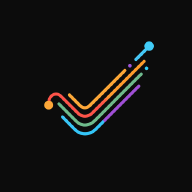
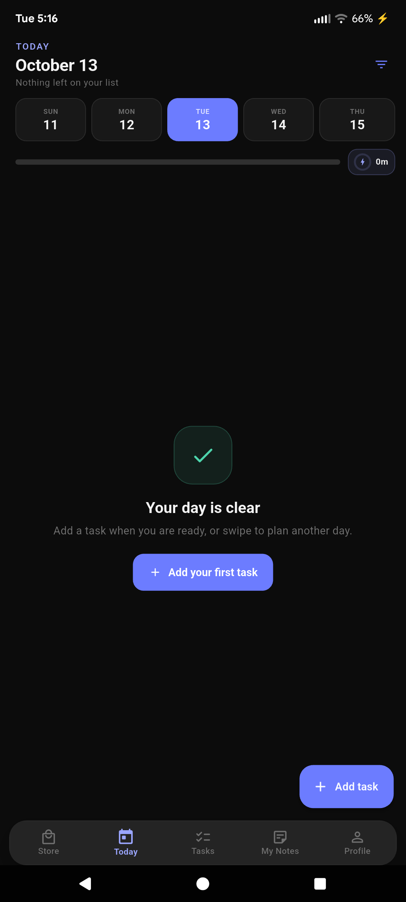

<div align="center">
  

# NextLevel

**Make room for the goals you care about.**

Plan tasks, build routines, and see your progress in one focused workspace.

[](https://github.com/kargalar/nextlevel/releases/latest) [](https://github.com/kargalar/nextlevel/releases/latest) [](LICENSE)

[Download for Android ↓](https://github.com/kargalar/nextlevel/releases/latest) · [Build from source](#build-from-source) · [Report an issue](https://github.com/kargalar/nextlevel/issues)

</div>



## Turn plans into a routine

Add a task to your day, set a reminder, then use focus timers and progress insights to keep moving. Save reusable templates for the routines you want to repeat.

## Features

- Create one-time tasks, recurring routines, and reusable templates.
- Track progress with timers, streaks, analytics, and a customizable home screen.
- Organize notes and projects alongside your tasks.
- Schedule alarms and reminders, including Android home-screen widgets.
- Back up and restore your data with Google Drive.
- Use voice input with a recognition language chosen independently from the app language.

## Download and install

Get the latest Android APK from [GitHub Releases](https://github.com/kargalar/nextlevel/releases/latest), download it to your device, and install the package.

## Build from source

Requirements: Flutter, the Android SDK, and a configured Android toolchain.

```sh
flutter pub get
flutter analyze
flutter test
flutter build apk --release
```

Google Drive backup setup is documented in [the backup guide](docs/google_drive_backup_setup.md). Keep service-account credentials and private keys out of the mobile app and repository.

## License

NextLevel is licensed under the GNU General Public License v3.0. See [LICENSE](LICENSE).
